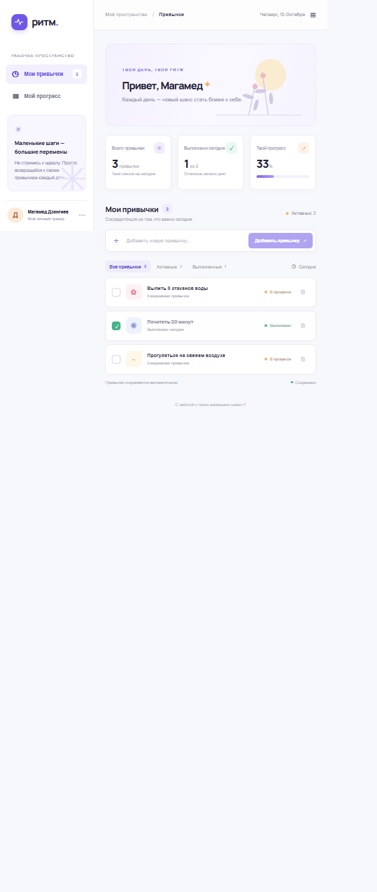

# Ритм — трекер привычек

Небольшое React-приложение для ежедневных привычек. Добавляйте свои действия, отмечайте выполненное и следите за прогрессом дня.

## Возможности

- Добавление привычек с ограничением длины названия.
- Отметка привычки как выполненной и возможность снять отметку.
- Удаление привычек.
- Фильтры: все, активные и выполненные.
- Счётчики и индикатор прогресса за сегодня.
- Автоматическое сохранение списка в `localStorage`.
- Адаптивный интерфейс для мобильных и настольных экранов.

## Стек

- React 18
- TypeScript
- Vite
- CSS
- `localStorage` браузера

Backend, база данных, Docker и тесты не используются.

## Запуск

Требуется Node.js 18 или новее.

```bash
npm install
npm run dev
```

Для production-сборки и локального просмотра:

```bash
npm run build
npm run preview
```

## Скриншоты

### Главный экран


### Мобильная версия



## Использование AI

ChatGPT помог создать стартовую структуру Vite, интерфейс, стили и логику списка привычек, а также подготовить этот README. AI-сгенерированный код помечен комментарием `AI-GENERATED: ChatGPT` в исходных файлах; результаты следует проверить перед дальнейшим использованием.

## Автор

Дзангиев Магамед Вахаевич
